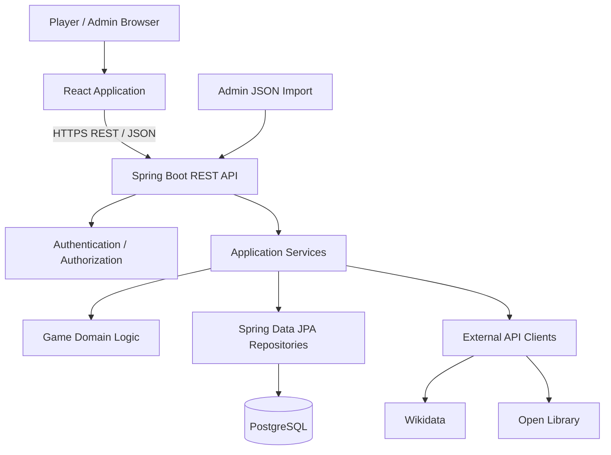
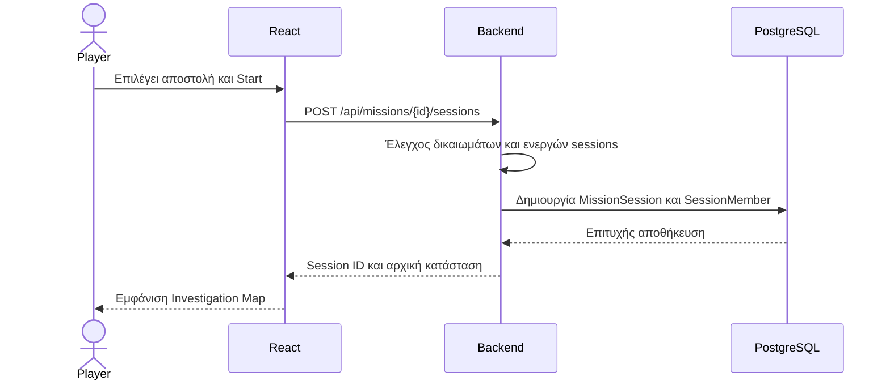
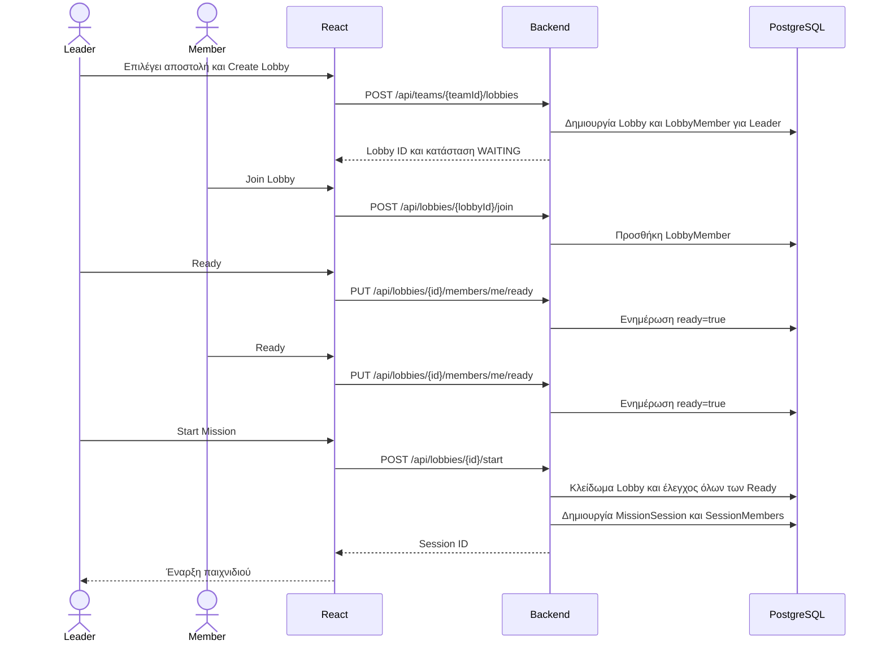
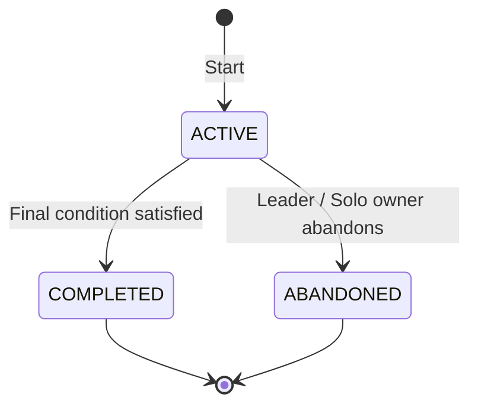
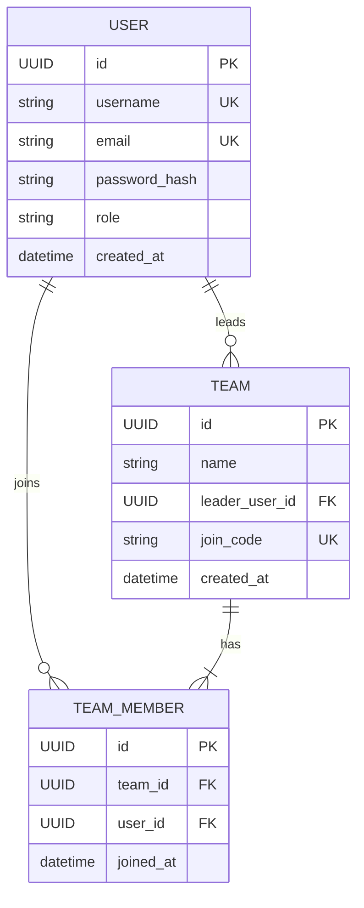
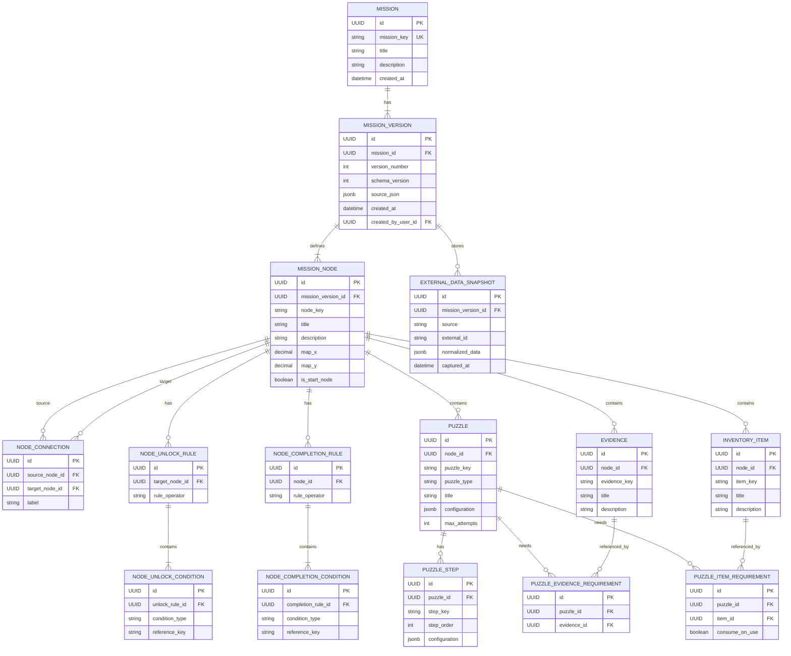
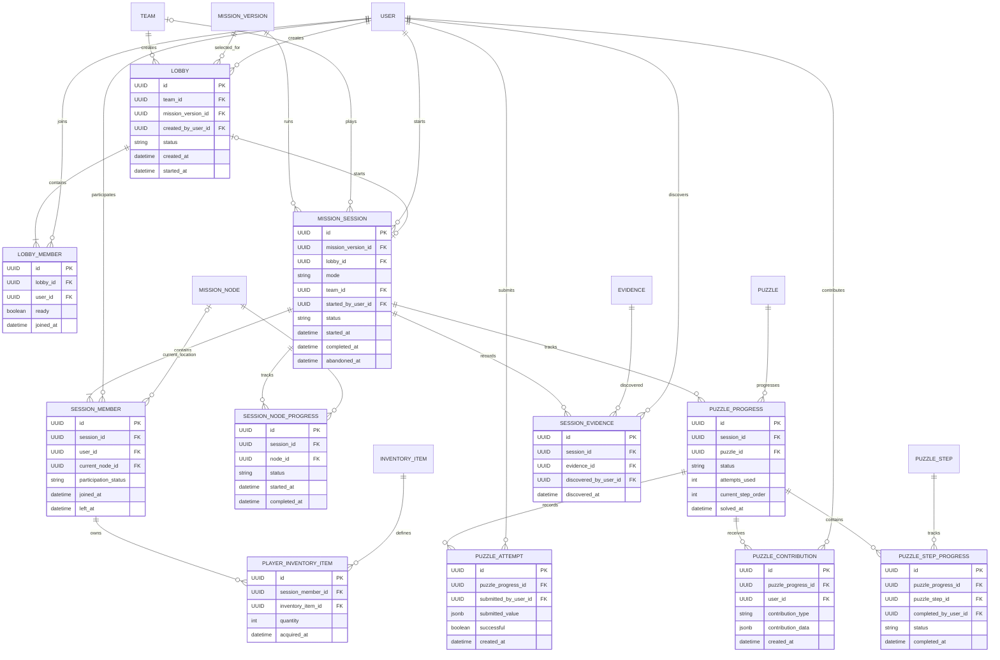
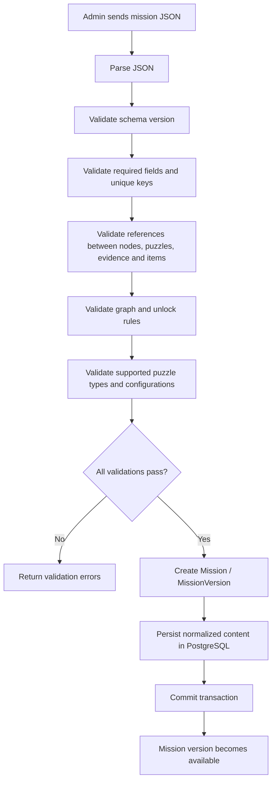
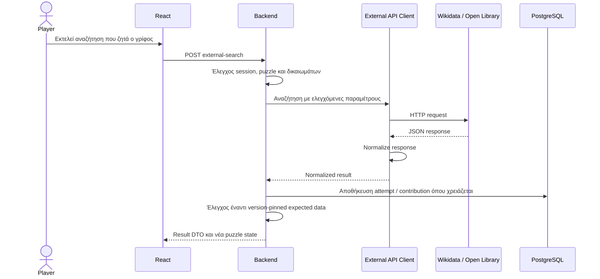

# EscapeHub — Αρχιτεκτονική Σχεδίαση

**Έκδοση εγγράφου:** 0.1  
**Κατάσταση:** Αρχικό αρχιτεκτονικό σχέδιο προς επιβεβαίωση πριν από την υλοποίηση  
**Τεχνολογίες:** Java 25, Spring Boot, Gradle, PostgreSQL, React + JavaScript, GitHub Actions, Docker  
**Σκοπός:** Να οριστεί ένας κοινός τεχνικός σχεδιασμός για την ομάδα ανάπτυξης και να αποτελέσει τη βάση για τα πρώτα καλά ορισμένα GitHub Issues.

---

## 1. Σκοπός και στόχοι

Το EscapeHub είναι μια διαδικτυακή πλατφόρμα συνεργατικών αποστολών μυστηρίου. Οι παίκτες διερευνούν έναν χάρτη από δωμάτια/περιοχές, ανακαλύπτουν στοιχεία, συλλέγουν αντικείμενα, λύνουν γρίφους και ξεκλειδώνουν νέες περιοχές. Οι αποστολές μπορούν να παιχτούν solo ή συνεργατικά από ομάδες 2–6 παικτών.

Η βασική αρχιτεκτονική αρχή είναι ο διαχωρισμός ανάμεσα:

1. **Mission Definition:** Το στατικό περιεχόμενο μιας αποστολής, δηλαδή ο χάρτης, τα δωμάτια, οι συνδέσεις, οι γρίφοι, τα στοιχεία, τα αντικείμενα και οι κανόνες.
2. **Mission Runtime:** Η πραγματική εκτέλεση μιας αποστολής από έναν παίκτη ή μια ομάδα, δηλαδή η θέση των παικτών, η πρόοδος των δωματίων, η κατάσταση των γρίφων, το κοινό ημερολόγιο στοιχείων και τα προσωπικά inventories.

Με αυτόν τον διαχωρισμό, η ίδια αποστολή μπορεί να παιχτεί πολλές φορές από διαφορετικούς παίκτες ή ομάδες χωρίς να μοιράζονται την πρόοδό τους. Νέες αποστολές θα προστίθενται ως δεδομένα μέσω JSON import, χωρίς να χρειάζεται αντιγραφή ή αλλαγή της βασικής λογικής του παιχνιδιού.

### 1.1 Στόχοι MVP

- Εγγραφή και είσοδος χρηστών.
- Δημιουργία ομάδων 2–6 μελών και συμμετοχή μέσω κωδικού.
- Δημόσιος κατάλογος διαθέσιμων αποστολών.
- Solo εκκίνηση και ομαδική εκκίνηση μέσω lobby.
- Investigation Map με nodes που αναπαριστούν δωμάτια/περιοχές.
- Τουλάχιστον μία ολοκληρωμένη μη γραμμική αποστολή με τρεις διαδρομές διερεύνησης και τελικό στάδιο που απαιτεί συνδυασμό ευρημάτων διαφορετικών διαδρομών.
- Κοινή πρόοδος ομάδας, κοινό Evidence Journal και προσωπικό Inventory ανά παίκτη.
- Προκαθορισμένοι τύποι γρίφων, συμπεριλαμβανομένων εξωτερικών δεδομένων, διαδοχικών ενεργειών και συνεργασίας δύο διαφορετικών παικτών.
- Πραγματικές κλήσεις σε Wikidata και Open Library, με διαχείριση σφαλμάτων και snapshots/fixtures για σταθερούς ελέγχους.
- Αποθήκευση προόδου, επανασύνδεση και συνέχιση αποστολής.
- Ένδειξη ολοκλήρωσης και αναλυτικά αποτελέσματα.
- Εισαγωγή νέων αποστολών ως δεδομένα μέσω admin-only JSON endpoint.
- Αυτοματοποιημένοι έλεγχοι, code reviews, CI/CD και τεκμηρίωση.

### 1.2 Εκτός αρχικού MVP

Τα παρακάτω δεν αποτελούν αρχικές απαιτήσεις υλοποίησης, εκτός αν προστεθούν αργότερα στο backlog:

- 3D γραφικά, φυσική ή game engine.
- Πλήρες real-time multiplayer με WebSockets.
- Λίστα φίλων, ένδειξη online/offline, matchmaking ή δημόσια lobby browser.
- Πλήρης γραφικός Mission Builder.
- Γενική μηχανή κανόνων ή γλώσσα scripting για αποστολές.
- Σύστημα βαθμολογίας, ποινών, achievements ή hints.
- Περίπλοκο σύστημα αποτυχιών ή χρονικά όρια αποστολών.

---

## 2. Τεχνολογίες και αρχές υλοποίησης

### 2.1 Συμφωνημένες τεχνολογίες

| Περιοχή | Τεχνολογία | Χρήση |
|---|---|---|
| Backend | Java 25 + Spring Boot | Επιχειρησιακή λογική και REST API |
| Build backend | Gradle Wrapper | Ενιαίο build σε όλους τους υπολογιστές |
| Database | PostgreSQL | Μόνιμη αποθήκευση δεδομένων |
| ORM / persistence | Spring Data JPA + Hibernate | Αντιστοίχιση Java entities σε πίνακες |
| Frontend | React + JavaScript | Σελίδες και αλληλεπίδραση παιχνιδιού |
| API communication | REST + JSON | Επικοινωνία frontend/backend |
| Backend testing | JUnit 5 + Mockito | Unit και integration tests |
| Version control | Git + GitHub | Branches, Issues, Pull Requests και releases |
| CI/CD | GitHub Actions | Αυτόματο build, tests και στατική ανάλυση |
| Containers | Docker + Docker Compose | Κοινό περιβάλλον εκτέλεσης |
| External data | Wikidata + Open Library | Πραγματικά δεδομένα για γρίφους |

### 2.2 Προτεινόμενα εργαλεία που χρειάζονται τελική επιβεβαίωση

Οι παρακάτω επιλογές είναι τεχνικές προτάσεις και όχι ακόμη δεσμευτικές αποφάσεις:

- **Vite** για το React development server και το frontend build.
- **React Router** για τη διαχείριση των σελίδων.
- **TanStack Query** για ανάκτηση, caching και ανανέωση δεδομένων από το backend.
- **Spring Security** για authentication και authorization.
- **BCrypt** για hashing των passwords.
- **Testcontainers** για integration tests με πραγματικό PostgreSQL container.
- **Checkstyle** για στατική ανάλυση και κοινό style κώδικα.
- **PIT** για mutation testing του module των κανόνων αποστολής.

Η επιλογή JWT ή secure cookie-based authentication δεν έχει οριστικοποιηθεί και πρέπει να καταγραφεί σε ξεχωριστό Architecture Decision Record πριν υλοποιηθεί το authentication.

### 2.3 Βασικές αρχές

1. Το backend είναι η μοναδική πηγή αλήθειας για την κατάσταση του παιχνιδιού.
2. Το frontend δεν αποφασίζει αν ένας γρίφος λύθηκε ή αν ένα δωμάτιο ξεκλειδώθηκε. Ζητά ενέργειες από το backend και εμφανίζει το αποτέλεσμα.
3. Κάθε Mission Session συνδέεται με συγκεκριμένο Mission Version.
4. Η πρόοδος διαφορετικών sessions είναι απομονωμένη.
5. Το κοινό state της ομάδας αποθηκεύεται στη βάση και δεν εξαρτάται από το αν οι παίκτες είναι ταυτόχρονα συνδεδεμένοι.
6. Τα external APIs καλούνται από το backend, όχι απευθείας από το React.
7. Οι κανόνες αποστολών είναι προκαθορισμένοι και επεκτάσιμοι, αλλά δεν υλοποιείται γενική μηχανή κανόνων.
8. Οι βασικές δοκιμές δεν εξαρτώνται από ζωντανά δημόσια APIs.

---

## 3. Συνολική αρχιτεκτονική συστήματος

Το frontend και το backend είναι διακριτά μέρη. Το React εμφανίζει το περιεχόμενο και στέλνει requests. Το Spring Boot ελέγχει δικαιώματα, εφαρμόζει τους κανόνες και επικοινωνεί με PostgreSQL και εξωτερικές υπηρεσίες.



### 3.1 Ευθύνη κάθε επιπέδου

**React frontend**
- Παρουσιάζει τις σελίδες και τα στοιχεία του παιχνιδιού.
- Εμφανίζει τον Investigation Map και τα διαθέσιμα δωμάτια.
- Επιτρέπει στον παίκτη να εξετάζει στοιχεία, να χρησιμοποιεί αντικείμενα και να αλληλεπιδρά με γρίφους.
- Εμφανίζει Lobby status και αποτελέσματα αποστολής.
- Δεν περιέχει την πραγματική λύση γρίφων ή τους κανόνες ξεκλειδώματος.

**Spring Boot REST API**
- Δέχεται και επικυρώνει HTTP requests.
- Ελέγχει αν ο χρήστης έχει δικαίωμα να εκτελέσει την ενέργεια.
- Μεταφέρει την εργασία στα κατάλληλα services.
- Επιστρέφει DTOs σε JSON μορφή.

**Application / Domain Services**
- Υλοποιούν την επιχειρησιακή λογική.
- Διαχειρίζονται τα state transitions.
- Ελέγχουν συνθήκες ξεκλειδώματος και ολοκλήρωσης.
- Εφαρμόζουν τους κανόνες των διαφορετικών τύπων γρίφων.
- Εξασφαλίζουν ότι οι αλλαγές που αφορούν κοινό state είναι ασφαλείς σε ταυτόχρονα requests.

**Repositories / PostgreSQL**
- Αποθηκεύουν μόνιμα τους χρήστες, τις ομάδες, τις αποστολές και την πρόοδο.
- Διατηρούν τις σχέσεις και τους περιορισμούς ακεραιότητας.

**External API Clients**
- Επικοινωνούν με Wikidata και Open Library.
- Μετατρέπουν τις εξωτερικές αποκρίσεις σε εσωτερική μορφή.
- Χειρίζονται timeouts, HTTP errors, μη έγκυρο JSON και περιορισμούς αιτημάτων.

---

## 4. Βασικές έννοιες του παιχνιδιού

### 4.1 Mission

Το `Mission` είναι η γενική ταυτότητα μιας αποστολής. Περιλαμβάνει στοιχεία όπως τίτλο, περιγραφή και μοναδικό key. Δεν αποθηκεύει την πρόοδο των παικτών.

### 4.2 Mission Version

Το `MissionVersion` είναι μια συγκεκριμένη, αμετάβλητη έκδοση του περιεχομένου μιας αποστολής. Περιλαμβάνει τα nodes, τις συνδέσεις, τους γρίφους, τα evidence, τα inventory items και τις συνθήκες.

Κάθε φορά που αλλάζει το περιεχόμενο μιας αποστολής, δημιουργείται νέα έκδοση. Δεν τροποποιούμε έκδοση που χρησιμοποιείται ήδη από ενεργό Mission Session.

Το `MissionSession` αποθηκεύει υποχρεωτικά το `mission_version_id` της έκδοσης που ξεκίνησε. Έτσι μια ενεργή αποστολή δεν επηρεάζεται αν ο Admin εισάγει αργότερα νέα έκδοση.

Η πλήρης διαδικασία Draft/Published έχει συμφωνηθεί ως μελλοντική επέκταση. Στο αρχικό MVP, ένα επιτυχώς επικυρωμένο JSON import δημιουργεί διαθέσιμη έκδοση. Η ξεχωριστή διαχείριση Draft και Published μπορεί να προστεθεί αργότερα χωρίς αλλαγή της βασικής έννοιας Mission Version.

### 4.3 Mission Node / Room

Κάθε `MissionNode` αντιστοιχεί σε ένα δωμάτιο ή σημείο διερεύνησης του Investigation Map. Περιέχει:
- Μοναδικό key μέσα στην έκδοση της αποστολής.
- Όνομα και περιγραφή.
- Συντεταγμένες εμφάνισης στον χάρτη.
- Ένδειξη αν είναι αρχικό node.
- Συνδέσεις με άλλα nodes.
- Γρίφους, evidence και inventory items που βρίσκονται σε αυτό.
- Προϋποθέσεις ολοκλήρωσης.

Ο χάρτης είναι γραφική αναπαράσταση της δομής της αποστολής. Δεν απαιτούνται 3D γραφικά ή φυσική κίνηση.

### 4.4 Node Connections και Unlock Rules

Χρειάζεται να διαχωρίζουμε δύο έννοιες:

- `NodeConnection`: περιγράφει τη σύνδεση δύο σημείων στον χάρτη.
- `NodeUnlockRule`: περιγράφει τις συνθήκες που πρέπει να εκπληρωθούν για να ξεκλειδώσει ένα node.

Αυτός ο διαχωρισμός επιτρέπει να εμφανίζονται οι συνδέσεις στον χάρτη χωρίς να χρειάζεται κάθε οπτική γραμμή να αντιστοιχεί σε έναν κανόνα ξεκλειδώματος.

Οι συνθήκες υποστηρίζουν:
- `AND`: πρέπει να ικανοποιούνται όλες οι συνθήκες της ομάδας.
- `OR`: αρκεί να ικανοποιείται τουλάχιστον μία συνθήκη της ομάδας.

Αν ένα node έχει περισσότερα από ένα `NodeUnlockRule`, αρκεί να ικανοποιηθεί ένα από αυτά. Μέσα σε κάθε rule εφαρμόζεται ο δικός του τελεστής AND ή OR.

Προκαθορισμένοι τύποι συνθηκών:
- `NODE_COMPLETED`
- `PUZZLE_SOLVED`
- `EVIDENCE_DISCOVERED`

Νέοι τύποι συνθηκών προστίθενται μόνο όταν απαιτούνται από συγκεκριμένη λειτουργία και συνοδεύονται από tests. Δεν δημιουργείται γενική γλώσσα έκφρασης κανόνων.

**Μετακίνηση παικτών:** Κάθε Session Member έχει δική του τρέχουσα θέση. Μπορεί να μεταβεί σε οποιοδήποτε node έχει ξεκλειδωθεί για το session και να επιστρέψει σε προηγούμενο δωμάτιο. Το ξεκλείδωμα είναι κοινό, αλλά η τρέχουσα θέση είναι προσωπική.

### 4.5 Evidence

Το `Evidence` είναι ο ορισμός ενός στοιχείου μέσα σε συγκεκριμένη Mission Version. Δεν είναι το ίδιο με αντικείμενο του Inventory.

Όταν παίκτης ανακαλύπτει ένα Evidence:
1. Το backend ελέγχει ότι το Evidence ανήκει στη συγκεκριμένη έκδοση αποστολής και είναι διαθέσιμο στο τρέχον session.
2. Δημιουργείται εγγραφή στο `SessionEvidence`.
3. Αποθηκεύονται ο παίκτης που το ανακάλυψε και η ημερομηνία ανακάλυψης.
4. Το στοιχείο εμφανίζεται αυτόματα στο κοινό Evidence Journal.

Το Evidence Journal είναι κοινό για όλα τα μέλη του Mission Session. Η ίδια εγγραφή δεν δημιουργείται δεύτερη φορά για το ίδιο session και evidence.

### 4.6 Inventory Item

Το `InventoryItem` είναι ο ορισμός ενός αντικειμένου μιας αποστολής. Το αντικείμενο που αποκτά ένας παίκτης αποθηκεύεται στο προσωπικό του `PlayerInventoryItem`.

Κανόνες:
- Κάθε παίκτης έχει δικό του inventory ανά Mission Session.
- Ένα αντικείμενο δεν μεταφέρεται αυτόματα στο inventory άλλου παίκτη.
- Ο κάτοχος του αντικειμένου μπορεί να το χρησιμοποιήσει σε γρίφο.
- Η χρήση μπορεί να το καταναλώσει ή να το διατηρήσει, ανάλογα με τη ρύθμιση του συγκεκριμένου puzzle/item requirement.
- Η επιτυχής χρήση σε κοινό γρίφο μπορεί να αλλάξει την κοινή κατάσταση του puzzle.

### 4.7 Mission Session

Το `MissionSession` είναι μία συγκεκριμένη εκτέλεση μιας συγκεκριμένης `MissionVersion`.

Υποστηρίζει δύο modes:
- `SOLO`: δημιουργείται απευθείας από τον χρήστη, χωρίς lobby και με έναν συμμετέχοντα.
- `TEAM`: δημιουργείται από το lobby του αρχηγού, με τους συμμετέχοντες που έχουν εισέλθει και δηλώσει Ready.

Μια ομάδα ή ένας χρήστης δεν μπορεί να έχει περισσότερες από μία ενεργές αποστολές ταυτόχρονα. Τα μέλη ενός ενεργού team session δεν μπορούν να ξεκινήσουν δεύτερη αποστολή ως solo ή με άλλη ομάδα μέχρι να ολοκληρωθεί ή να εγκαταλειφθεί το υπάρχον session.

### 4.8 Lobby

Το Lobby είναι ο προσωρινός χώρος αναμονής πριν από ένα ομαδικό Mission Session.

- Δημιουργείται από τον αρχηγό της ομάδας για συγκεκριμένη αποστολή/έκδοση.
- Ο αρχηγός προστίθεται αυτόματα ως μέλος του lobby, αλλά πρέπει και ο ίδιος να δηλώσει Ready.
- Άλλα μέλη της ομάδας εισέρχονται στο lobby όταν επιλέξουν Join.
- Μέλη της ομάδας που δεν έχουν εισέλθει στο lobby δεν εμποδίζουν την έναρξη.
- Το ομαδικό session ξεκινά μόνο όταν υπάρχουν 2–6 μέλη στο lobby και όλα έχουν `ready = true`.
- Ο αρχηγός είναι ο μόνος που μπορεί να ξεκινήσει ή να ακυρώσει το lobby. Αν ο αρχηγός επιλέξει ρητά Leave/Cancel πριν από την έναρξη, το lobby γίνεται `CANCELLED`.
- Αν ένα απλό μέλος επιλέξει Leave πριν από την έναρξη, αφαιρείται από τους ενεργούς συμμετέχοντες του lobby. Μπορεί να εισέλθει ξανά όσο το lobby παραμένει `WAITING` και, αν συμβεί αυτό, πρέπει να δηλώσει ξανά Ready.
- Αν κάποιος δεν είναι Ready, το backend απορρίπτει την έναρξη και επιστρέφει ποια μέλη δεν είναι έτοιμα.
- Κατά την έναρξη δημιουργούνται οι εγγραφές `SessionMember` για όλους τους συμμετέχοντες. Το roster παγώνει.
- Νέα μέλη που εισέρχονται στην ομάδα μετά την έναρξη δεν προστίθενται στο ήδη ενεργό session.

Δεν υλοποιείται σύστημα φίλων ή γενική online/offline παρουσία. Η κατάσταση του lobby εμφανίζεται στα μέλη της συγκεκριμένης ομάδας και δεν δημιουργείται δημόσιος κατάλογος lobby. Όσο η οθόνη lobby είναι ανοικτή, το frontend μπορεί να ανανεώνει την κατάστασή του με περιοδικά REST requests (polling). Δεν απαιτούνται WebSockets για το MVP. Αν ο browser κλείσει απρόσμενα, δεν υπάρχει αυτόματος μηχανισμός online/offline για να αφαιρέσει το μέλος· το μέλος παραμένει στο lobby μέχρι να αποχωρήσει ρητά ή να το αφαιρέσει ο αρχηγός μέσω σχετικής λειτουργίας, εφόσον αποφασιστεί να υλοποιηθεί.

---

## 5. Βασικές ροές χρήσης

### 5.1 Solo Mission Flow



Solo mode δεν δημιουργεί Lobby. Δημιουργείται απευθείας Mission Session με `mode = SOLO` και έναν Session Member.

### 5.2 Team Lobby και έναρξη αποστολής



Η δημιουργία του Session και η μεταβολή του Lobby σε `STARTED` γίνονται σε μία database transaction. Αν ο έλεγχος αποτύχει, δεν δημιουργείται μερικό Session.

### 5.3 Εξερεύνηση και πρόοδος

1. Το frontend ζητά την τρέχουσα κατάσταση του session.
2. Το backend επιστρέφει τα διαθέσιμα nodes, την προσωπική θέση του παίκτη, το κοινό Evidence Journal, το προσωπικό Inventory και την πρόοδο των γρίφων που έχει δικαίωμα να δει.
3. Ο παίκτης επιλέγει ένα ξεκλειδωμένο node.
4. Το backend ελέγχει την πρόσβαση και ενημερώνει το `SessionMember.current_node_id`.
5. Ο παίκτης εξετάζει στοιχεία, αποκτά αντικείμενα και αλληλεπιδρά με γρίφους.
6. Κάθε επιτυχημένη ενέργεια ενημερώνει την κατάσταση του session.
7. Μετά από ενέργεια που επηρεάζει τις προϋποθέσεις, εκτελείται επανέλεγχος ξεκλειδώματος και ολοκλήρωσης.

### 5.4 Αποσύνδεση, αποχώρηση και επανασύνδεση

- Αν ο browser κλείσει απρόσμενα, δεν αλλάζει αυτομάτως η κατάσταση του Session Member. Η πρόοδος παραμένει στη βάση.
- Αν ο παίκτης επιλέξει Leave Session, το `SessionMember` γίνεται `LEFT`.
- Η θέση, το προσωπικό inventory και οι προηγούμενες συνεισφορές του διατηρούνται.
- Ο ίδιος παίκτης μπορεί να επιστρέψει στο ίδιο ενεργό session και να γίνει ξανά `ACTIVE`.
- Η αποχώρηση ενός παίκτη δεν εγκαταλείπει ολόκληρο το session.
- Ο αρχηγός μπορεί να εγκαταλείψει ολόκληρη την ομαδική αποστολή. Στο solo, ο δημιουργός/μοναδικός παίκτης μπορεί να εγκαταλείψει τη δική του αποστολή.
- Όταν το session ολοκληρωθεί ή εγκαταλειφθεί, όλα τα μέλη λαμβάνουν τελική κατάσταση `FINISHED`.

### 5.5 Ολοκλήρωση αποστολής

Η αποστολή ολοκληρώνεται όταν εκπληρωθεί η τελική συνθήκη που έχει οριστεί στην Mission Version. Το backend:
- αλλάζει το status του session σε `COMPLETED`,
- αποθηκεύει `completed_at`,
- οριστικοποιεί τη συμμετοχή των Session Members,
- παράγει αποτελέσματα από τα αποθηκευμένα δεδομένα.

Η οθόνη αποτελεσμάτων εμφανίζει τουλάχιστον:
- συνολικό χρόνο ολοκλήρωσης,
- γρίφους που λύθηκαν,
- στοιχεία που ανακαλύφθηκαν,
- συμμετοχή/συνεισφορές παικτών.

Δεν υπάρχει αποτυχία λόγω χρονικού ορίου. Το session παραμένει ενεργό μέχρι να ολοκληρωθεί ή να εγκαταλειφθεί.

---

## 6. State Models

### 6.1 Lobby Status

| Κατάσταση | Περιγραφή |
|---|---|
| `WAITING` | Το lobby δέχεται μέλη και Ready δηλώσεις |
| `STARTED` | Το Mission Session δημιουργήθηκε επιτυχώς |
| `CANCELLED` | Ο αρχηγός ακύρωσε το lobby |

Lobby Member:
- `ready = false`: δεν έχει δηλώσει ετοιμότητα.
- `ready = true`: είναι έτοιμος.

Η δημιουργία Mission Session επιτρέπεται μόνο αν:
- ο requester είναι ο αρχηγός,
- το lobby είναι `WAITING`,
- υπάρχουν 2–6 lobby members,
- όλα τα lobby members είναι Ready,
- κανένα μέλος δεν συμμετέχει ήδη σε άλλο ενεργό session,
- η ομάδα δεν έχει άλλο ενεργό session.

### 6.2 Mission Session Status



Δεν υπάρχει κατάσταση FAILED λόγω χρόνου ή λανθασμένων απαντήσεων.

### 6.3 Session Member Status

| Κατάσταση | Περιγραφή |
|---|---|
| `ACTIVE` | Συμμετέχει κανονικά στο session |
| `LEFT` | Έχει αποχωρήσει προσωρινά αλλά μπορεί να επανέλθει |
| `FINISHED` | Το session ολοκληρώθηκε ή εγκαταλείφθηκε |

Η κατάσταση online/offline δεν αποθηκεύεται. Το `LEFT` σημαίνει ρητή ενέργεια αποχώρησης από το παιχνίδι και όχι απλώς κλείσιμο του browser.

### 6.4 Room / Node Progress

| Κατάσταση | Περιγραφή |
|---|---|
| `LOCKED` | Δεν έχουν ικανοποιηθεί οι προϋποθέσεις |
| `AVAILABLE` | Έχει ξεκλειδωθεί και μπορεί να επισκεφθεί |
| `IN_PROGRESS` | Έχει αρχίσει η διερεύνησή του |
| `COMPLETED` | Έχουν ικανοποιηθεί οι συνθήκες ολοκλήρωσης |

Η πρόοδος node είναι κοινή ανά Mission Session. Η θέση κάθε παίκτη είναι ξεχωριστή.

### 6.5 Puzzle Progress

| Κατάσταση | Περιγραφή |
|---|---|
| `LOCKED` | Δεν είναι ακόμη διαθέσιμο |
| `AVAILABLE` | Μπορεί να ξεκινήσει |
| `IN_PROGRESS` | Έχει γίνει τουλάχιστον μία σχετική ενέργεια |
| `SOLVED` | Ο γρίφος λύθηκε επιτυχώς |

Το `PuzzleProgress` είναι κοινό για το Session. Οι προσπάθειες είναι επίσης κοινές: αν ένας γρίφος έχει όριο, όλες οι προσπάθειες όλων των παικτών μετρούν στο ίδιο όριο. Η προεπιλογή είναι απεριόριστες προσπάθειες (`max_attempts = null`). Κάθε προσπάθεια καταγράφεται ξεχωριστά.

---

## 7. Τύποι γρίφων και μηχανισμός επίλυσης

Το EscapeHub δεν θα υλοποιήσει γενική μηχανή γρίφων. Θα υπάρχουν συγκεκριμένοι, προκαθορισμένοι τύποι με ξεχωριστούς handlers στο backend.

### 7.1 Question Puzzle

- Ο παίκτης υποβάλλει απάντηση.
- Το backend την κανονικοποιεί σύμφωνα με τους κανόνες του συγκεκριμένου γρίφου (π.χ. trim, πεζά/κεφαλαία, επιτρεπόμενες εναλλακτικές).
- Η σωστή απάντηση δεν αποστέλλεται ποτέ στο frontend.
- Κάθε υποβολή καταγράφεται ως Puzzle Attempt.

### 7.2 External Data Puzzle

- Ο γρίφος δίνει συγκεκριμένη ερώτηση/αναζήτηση στον παίκτη.
- Ο παίκτης αναζητά πληροφορία μέσω της διεπαφής του παιχνιδιού.
- Το request περνά από το Spring Boot, το οποίο καλεί Wikidata ή Open Library.
- Η απόκριση μετατρέπεται σε εσωτερικό DTO.
- Η λύση ελέγχεται από το backend με βάση σταθερά identifiers και δεδομένα της συγκεκριμένης Mission Version.
- Μία αποστολή μπορεί να απαιτεί μεταφορά ευρήματος από αναζήτηση Wikidata σε επόμενη αναζήτηση Open Library ή συσχέτιση αποτελεσμάτων των δύο πηγών.

Αν ένα external API αποτύχει ή καθυστερήσει, επιστρέφεται τεχνικό σφάλμα/δυνατότητα retry. Η αποτυχία υπηρεσίας δεν καταγράφεται ως λανθασμένη απάντηση του παίκτη.

### 7.3 Sequential Puzzle

- Ο γρίφος αποτελείται από διατεταγμένα βήματα.
- Αποθηκεύεται ποιο βήμα έχει ολοκληρωθεί.
- Κάθε βήμα μπορεί να έχει πολιτική συμμετοχής που ορίζεται από τον συγκεκριμένο τύπο/ρύθμιση του γρίφου.
- Μπορεί να επιτρέπεται σε διαφορετικά μέλη να ολοκληρώνουν διαδοχικά βήματα.
- Η πρόοδος είναι κοινή στο session και διατηρείται μετά από αποσύνδεση.

### 7.4 Collaborative Puzzle

- Απαιτεί συνεισφορά τουλάχιστον δύο διαφορετικών χρηστών.
- Το backend ελέγχει τα distinct user IDs των έγκυρων συνεισφορών.
- Δεν αρκεί δύο ενέργειες να προέρχονται από τον ίδιο χρήστη.
- Η ακριβής συνεισφορά που απαιτείται εξαρτάται από τη ρύθμιση του συγκεκριμένου puzzle.

### 7.5 Evidence Combination Puzzle

- Απαιτεί ένα ή περισσότερα Evidence που έχουν ήδη ανακαλυφθεί στο κοινό Journal.
- Μπορεί να απαιτεί επιπλέον απάντηση ή χρήση Inventory Item.
- Η διαθεσιμότητα όλων των απαιτούμενων στοιχείων ελέγχεται στο backend.

Ένας γρίφος μπορεί να καλύπτει περισσότερες από μία απαιτήσεις του MVP. Για παράδειγμα, ένας Collaborative Puzzle μπορεί να απαιτεί Evidence που αποκτήθηκε μέσω External Data Puzzle.

### 7.6 Puzzle Handler Design

Προτείνεται Strategy-style σχεδίαση με κοινό interface και έναν handler ανά τύπο:

```java
public interface PuzzleHandler {
    PuzzleType supportedType();

    PuzzleActionResult handle(
        Puzzle puzzle,
        PuzzleProgress progress,
        PuzzleActionRequest request,
        User actor
    );
}
```

Ενδεικτικοί handlers:
- `QuestionPuzzleHandler`
- `ExternalDataPuzzleHandler`
- `SequentialPuzzleHandler`
- `CollaborativePuzzleHandler`
- `EvidenceCombinationPuzzleHandler`

Το `PuzzleService` επιλέγει τον κατάλληλο handler. Η προσθήκη νέου τύπου γρίφου απαιτεί νέο handler, tests και υποστηριζόμενη διαμόρφωση JSON, όχι αντιγραφή ολόκληρου του μηχανισμού αποστολής.

### 7.7 Attempts και contributions

- Το `PuzzleProgress.attempts_used` μετρά τις κοινές προσπάθειες του session.
- Κάθε προσπάθεια αποθηκεύεται στο `PuzzleAttempt` με τον χρήστη που την υπέβαλε, την τιμή/ενέργεια, το αποτέλεσμα και το timestamp.
- Τα βήματα και οι συνεργατικές ενέργειες καταγράφονται στο `PuzzleContribution` ή/και στο `PuzzleStepProgress`.
- Αν `max_attempts` είναι null, δεν υπάρχει όριο.
- Αν έχει οριστεί αριθμητικό όριο, εφαρμόζεται στο κοινό PuzzleProgress και όχι ξεχωριστά ανά παίκτη.

---

## 8. Προτεινόμενο Domain Model και Database Schema

Τα παρακάτω διαγράμματα αποτελούν το προτεινόμενο λογικό μοντέλο. Τα ακριβή SQL types, indexes και migrations θα οριστικοποιηθούν κατά την υλοποίηση.

### 8.1 Users και Teams



Κανόνες:
- Το `Team.leader_user_id` αναφέρεται στον αρχηγό.
- Ο αρχηγός πρέπει να είναι και μέλος του `Team`.
- Ένα ζεύγος `(team_id, user_id)` είναι μοναδικό.
- Η ομάδα έχει μέγιστο μέγεθος 6 μελών. Για ομαδική αποστολή απαιτούνται τουλάχιστον 2 συμμετέχοντες.
- Ο κωδικός συμμετοχής είναι μοναδικός και παραμένει σταθερός στο MVP. Η δυνατότητα ανανέωσης μπορεί να προστεθεί αργότερα.
- Η συμμετοχή μέσω κωδικού γίνεται αυτόματα, εφόσον ο χρήστης είναι εγγεγραμμένος και υπάρχει διαθέσιμη θέση.

### 8.2 Mission Definition



#### Σημειώσεις για το Mission Definition

- Τα `node_key`, `puzzle_key`, `evidence_key` και `item_key` είναι σταθερά identifiers μέσα σε μία Mission Version και χρησιμοποιούνται στο JSON import.
- Τα `map_x` και `map_y` καθορίζουν τη θέση του node στον Investigation Map. Είναι δεδομένα εμφάνισης, όχι συντεταγμένες φυσικής κίνησης.
- Το `NodeConnection` περιγράφει οπτική/λογική σύνδεση στον χάρτη. Το ξεκλείδωμα καθορίζεται από τα `NodeUnlockRule`.
- Ένα node χωρίς unlock rules και με `is_start_node = true` είναι αρχικά διαθέσιμο.
- Αν ένα node έχει πολλαπλά unlock rules, αρκεί ένα rule να ικανοποιηθεί. Μέσα σε κάθε rule εφαρμόζεται AND ή OR.
- Οι condition references γίνονται μέσω `reference_key`. Ο JSON Import Validator οφείλει να ελέγχει ότι το key υπάρχει, είναι σωστού τύπου και ανήκει στην ίδια Mission Version. Εναλλακτικά, σε μεταγενέστερη έκδοση μπορούν να χρησιμοποιηθούν ειδικοί foreign keys ανά condition type.
- Τα `configuration` πεδία των puzzles περιέχουν μόνο τη διαμόρφωση του συγκεκριμένου προκαθορισμένου τύπου. Δεν αποτελούν γενική γλώσσα κανόνων.
- Οι σωστές απαντήσεις και τα στοιχεία επικύρωσης δεν επιστρέφονται στα public frontend DTOs.
- Το `source_json` διατηρεί το αρχικό εισαγόμενο αρχείο για ιχνηλασιμότητα. Οι κανονικοποιημένες εγγραφές αποτελούν τα δεδομένα που χρησιμοποιεί το runtime.
- Το `ExternalDataSnapshot` αποθηκεύει σταθερά, κανονικοποιημένα δεδομένα που χρησιμοποιούνται για την έκδοση της αποστολής και τους επαναλήψιμους ελέγχους.

### 8.3 Lobby και Mission Runtime



#### Σημειώσεις για το Runtime

- Το `MISSION_SESSION.team_id` είναι nullable. Σε `TEAM` mode πρέπει να έχει τιμή. Σε `SOLO` mode είναι null. Το `started_by_user_id` είναι πάντα συμπληρωμένο. Το `lobby_id` είναι nullable και συμπληρώνεται μόνο για team session που ξεκίνησε από lobby· είναι μοναδικό ώστε ένα lobby να μην ξεκινήσει δύο sessions.
- Το `SESSION_MEMBER` δημιουργείται για κάθε συμμετέχοντα κατά την έναρξη. Στο solo session υπάρχει ένας Session Member. Το roster είναι snapshot των lobby members που ήταν μέσα και Ready τη στιγμή του Start.
- Το `SESSION_MEMBER.current_node_id` είναι η προσωπική θέση του συγκεκριμένου παίκτη. Η αναφορά πρέπει να δείχνει σε node της ίδιας Mission Version με το session· αυτό ελέγχεται από το service layer και, όπου είναι εφικτό, με composite constraints στη βάση.
- Το `SESSION_NODE_PROGRESS` είναι κοινό ανά session και node.
- Το `PUZZLE_PROGRESS` είναι κοινό ανά session και puzzle. Δεν δημιουργείται διαφορετικό progress ανά παίκτη.
- Οι προσπάθειες όλων των παικτών αυξάνουν το ίδιο `attempts_used`.
- Το `PUZZLE_ATTEMPT` κρατά ιστορικό κάθε προσπάθειας. Το `PUZZLE_CONTRIBUTION` κρατά ενέργειες που συνεισφέρουν στην επίλυση. Για απλά puzzles μπορεί να δημιουργείται και attempt και contribution από την ίδια ενέργεια, εφόσον χρειάζεται.
- Το `PUZZLE_STEP_PROGRESS` αποθηκεύει την ολοκλήρωση κάθε βήματος και ποιος το ολοκλήρωσε.
- Το `SESSION_EVIDENCE` είναι κοινό. Συνιστάται unique constraint στο `(session_id, evidence_id)`, ώστε το ίδιο Evidence να μην καταγραφεί δύο φορές. Η αναφορά πρέπει να δείχνει σε Evidence της Mission Version του session.
- Το `PLAYER_INVENTORY_ITEM` συνδέεται με `SESSION_MEMBER`, όχι απευθείας με `USER`, επειδή το inventory ανήκει στον συγκεκριμένο παίκτη μέσα σε συγκεκριμένο session.
- Συνιστώνται unique constraints στα `(session_id, user_id)`, `(session_id, node_id)`, `(session_id, puzzle_id)`, `(session_id, evidence_id)`, `(session_member_id, inventory_item_id)` και `(puzzle_progress_id, puzzle_step_id)`.

### 8.4 Περιορισμοί και ακεραιότητα δεδομένων

Οι ακόλουθοι κανόνες πρέπει να προστατεύονται από το backend και, όπου είναι εφικτό, από τη βάση:

1. Ένας χρήστης δεν μπορεί να εμφανίζεται δύο φορές στην ίδια ομάδα.
2. Μια ομάδα δεν ξεπερνά τα 6 μέλη.
3. Ο αρχηγός είναι μέλος της ομάδας.
4. Ένα lobby περιλαμβάνει μόνο μέλη της αντίστοιχης ομάδας.
5. Ένα team lobby που ξεκινά έχει 2–6 μέλη και όλα είναι Ready.
6. Ένα Lobby μπορεί να ξεκινήσει μόνο από τον αρχηγό.
7. Κάθε Session Member ανήκει σε ένα session και έναν user.
8. Ένα session χρησιμοποιεί μόνο μία συγκεκριμένη Mission Version.
9. Ένα player/session δεν μπορεί να ανακαλύψει το ίδιο Evidence δεύτερη φορά.
10. Ένα session έχει ένα κοινό PuzzleProgress ανά puzzle.
11. Οι προσπάθειες περιορισμένου puzzle είναι κοινές για όλους τους συμμετέχοντες.
12. Ο χρήστης μπορεί να χρησιμοποιήσει μόνο αντικείμενα του δικού του session inventory.
13. Ένας χρήστης δεν συμμετέχει σε δεύτερο ενεργό session όσο παραμένει δεσμευμένος σε προηγούμενο.
14. Η κατάσταση ενός session δεν μπορεί να αλλάξει σε COMPLETED χωρίς να εκπληρωθεί η τελική συνθήκη.
15. Η κατάσταση ενός session δεν μπορεί να αλλάξει σε ABANDONED από απλό μέλος.

Για τον κανόνα «μία ενεργή αποστολή ανά χρήστη ή ομάδα» θα χρησιμοποιηθεί έλεγχος σε service layer μέσα σε transaction και κατάλληλοι database constraints/indexes όπου είναι εφικτό. Ιδιαίτερη προσοχή χρειάζεται στην ταυτόχρονη εκκίνηση δύο sessions από διαφορετικά requests.

---

## 9. Mission JSON Import

Οι αποστολές θα εισάγονται μέσω admin-only REST endpoint που δέχεται JSON.

### 9.1 Import Flow



### 9.2 Validation που πρέπει να εκτελείται

- Το JSON έχει υποστηριζόμενο `schemaVersion`.
- Η αποστολή έχει μοναδικό key, τίτλο και περιγραφή.
- Υπάρχουν μοναδικά keys για nodes, puzzles, evidence και inventory items.
- Υπάρχει τουλάχιστον ένα start node.
- Κάθε connection αναφέρεται σε nodes της ίδιας Mission Version.
- Κάθε condition reference δείχνει σε υπαρκτό στοιχείο του σωστού τύπου.
- Κάθε puzzle έχει υποστηριζόμενο `puzzleType` και έγκυρη type-specific configuration.
- Κάθε puzzle step έχει μοναδική σειρά μέσα στον γρίφο.
- Τα Evidence και Inventory Items που απαιτούνται από puzzle ανήκουν στην ίδια Mission Version.
- Δεν υπάρχουν αδύνατες ή κυκλικές εξαρτήσεις ξεκλειδώματος που εμποδίζουν την πρόοδο.
- Υπάρχει διαδρομή από start node προς τα απαιτούμενα τελικά στάδια.
- Για την αποστολή MVP υπάρχουν τουλάχιστον τρεις διαδρομές διερεύνησης και τέσσερις γρίφοι/δοκιμασίες συνολικά.
- Το τελικό βήμα απαιτεί ευρήματα από διαφορετικές διαδρομές.

Η εισαγωγή πρέπει να είναι atomic: αν αποτύχει validation ή persistence, δεν παραμένουν μισοδημιουργημένες εγγραφές.

### 9.3 Ενδεικτικό JSON Format

Το παρακάτω είναι ενδεικτικό περίγραμμα και όχι τελικό JSON Schema. Τα keys είναι identifiers μέσα στο αρχείο εισαγωγής.

```json
{
  "schemaVersion": 1,
  "mission": {
    "key": "sample-mission",
    "title": "Sample Mystery",
    "description": "An example mission used to demonstrate the format.",
    "versionNumber": 1
  },
  "nodes": [
    {
      "key": "entry",
      "title": "Central Archive",
      "description": "The starting investigation area.",
      "position": { "x": 50, "y": 50 },
      "startNode": true
    },
    {
      "key": "route-a",
      "title": "Investigation A",
      "description": "First investigation route.",
      "position": { "x": 20, "y": 25 },
      "startNode": false
    },
    {
      "key": "route-b",
      "title": "Investigation B",
      "description": "Second investigation route.",
      "position": { "x": 50, "y": 15 },
      "startNode": false
    },
    {
      "key": "route-c",
      "title": "Investigation C",
      "description": "Third investigation route.",
      "position": { "x": 80, "y": 25 },
      "startNode": false
    },
    {
      "key": "final-room",
      "title": "Final Room",
      "description": "The final investigation area.",
      "position": { "x": 50, "y": 85 },
      "startNode": false
    }
  ],
  "connections": [
    { "key": "entry-a", "from": "entry", "to": "route-a" },
    { "key": "entry-b", "from": "entry", "to": "route-b" },
    { "key": "entry-c", "from": "entry", "to": "route-c" },
    { "key": "a-final", "from": "route-a", "to": "final-room" },
    { "key": "b-final", "from": "route-b", "to": "final-room" },
    { "key": "c-final", "from": "route-c", "to": "final-room" }
  ],
  "unlockRules": [
    {
      "targetNode": "route-a",
      "operator": "AND",
      "conditions": [
        { "type": "PUZZLE_SOLVED", "reference": "entry-puzzle" }
      ]
    },
    {
      "targetNode": "final-room",
      "operator": "AND",
      "conditions": [
        { "type": "EVIDENCE_DISCOVERED", "reference": "evidence-a" },
        { "type": "EVIDENCE_DISCOVERED", "reference": "evidence-b" },
        { "type": "EVIDENCE_DISCOVERED", "reference": "evidence-c" }
      ]
    }
  ],
  "puzzles": [
    {
      "key": "entry-puzzle",
      "node": "entry",
      "type": "QUESTION",
      "title": "Initial Question",
      "maxAttempts": null,
      "configuration": {
        "acceptedAnswers": ["example answer"],
        "caseSensitive": false
      }
    },
    {
      "key": "external-puzzle-a",
      "node": "route-a",
      "type": "EXTERNAL_DATA",
      "title": "Find the Historical Record",
      "maxAttempts": null,
      "configuration": {
        "source": "WIKIDATA",
        "searchPrompt": "Find the person described by the clue.",
        "expectedExternalId": "Q000000"
      }
    }
  ],
  "evidence": [
    {
      "key": "evidence-a",
      "node": "route-a",
      "title": "Evidence A",
      "description": "A discovered fact from route A."
    },
    {
      "key": "evidence-b",
      "node": "route-b",
      "title": "Evidence B",
      "description": "A discovered fact from route B."
    },
    {
      "key": "evidence-c",
      "node": "route-c",
      "title": "Evidence C",
      "description": "A discovered fact from route C."
    }
  ],
  "inventoryItems": []
}
```

Σημείωση: Το πραγματικό JSON Schema πρέπει να οριστεί ξεχωριστά. Το παραπάνω παράδειγμα δείχνει τη λογική της μορφής και όχι όλα τα πεδία κάθε τύπου γρίφου.

---

## 10. Backend Architecture – Spring Boot

### 10.1 Προτεινόμενη δομή packages

```text
gr.escaphub/
|
|-- EscapeHubApplication.java
|
|-- config/
|   |-- CorsConfig.java
|   |-- JacksonConfig.java
|   |-- OpenApiConfig.java
|
|-- common/
|   |-- exception/
|   |-- response/
|   |-- validation/
|
|-- security/
|   |-- config/
|   |-- controller/
|   |-- service/
|   |-- dto/
|
|-- user/
|   |-- controller/
|   |-- service/
|   |-- repository/
|   |-- gr.escaphub.mission.definition.entity/
|   |-- dto/
|
|-- team/
|   |-- controller/
|   |-- service/
|   |-- repository/
|   |-- gr.escaphub.mission.definition.entity/
|   |-- dto/
|
|-- mission/
|   |-- definition/
|   |   |-- controller/
|   |   |-- service/
|   |   |-- repository/
|   |   |-- gr.escaphub.mission.definition.entity/
|   |   |-- dto/
|   |   |-- importer/
|   |
|   |-- lobby/
|   |   |-- controller/
|   |   |-- service/
|   |   |-- repository/
|   |   |-- gr.escaphub.mission.definition.entity/
|   |   |-- dto/
|   |
|   |-- session/
|   |   |-- controller/
|   |   |-- service/
|   |   |-- repository/
|   |   |-- gr.escaphub.mission.definition.entity/
|   |   |-- dto/
|   |
|   |-- progression/
|   |   |-- service/
|   |   |-- rules/
|   |
|   |-- puzzle/
|   |   |-- handler/
|   |   |-- service/
|   |   |-- repository/
|   |   |-- gr.escaphub.mission.definition.entity/
|   |   |-- dto/
|   |
|   |-- evidence/
|   |-- inventory/
|
|-- integration/
|   |-- wikidata/
|   |-- openlibrary/
```

Η παραπάνω δομή είναι feature-oriented: κάθε κύριο κομμάτι του domain έχει δικό του package. Δεν χρειάζεται να δημιουργηθούν όλες οι κλάσεις από την πρώτη ημέρα. Οι κλάσεις προστίθενται όταν υλοποιείται το αντίστοιχο Issue.

### 10.2 Ρόλος βασικών layers

- **Controller:** Διαχειρίζεται HTTP requests/responses και καλεί services. Δεν περιέχει επιχειρησιακούς κανόνες.
- **Service:** Υλοποιεί τη λειτουργία και συντονίζει entities, repositories και handlers.
- **Repository:** Παρέχει πρόσβαση στα δεδομένα μέσω Spring Data JPA.
- **Entity:** Αντιπροσωπεύει δεδομένα που αποθηκεύονται στη βάση.
- **DTO:** Ορίζει τα δεδομένα που δέχεται ή επιστρέφει το API. Δεν επιστρέφουμε απευθείας JPA entities.
- **Handler:** Υλοποιεί τη συμπεριφορά ενός συγκεκριμένου τύπου γρίφου.

### 10.3 Ενδεικτικά βασικά services

| Service | Ευθύνη |
|---|---|
| `UserService` | Εγγραφή και διαχείριση λογαριασμών |
| `TeamService` | Δημιουργία ομάδων, συμμετοχή με join code |
| `MissionCatalogService` | Προβολή διαθέσιμων αποστολών |
| `MissionImportService` | JSON parsing, validation και εισαγωγή Mission Version |
| `LobbyService` | Δημιουργία lobby, join, ready, start και cancel |
| `MissionSessionService` | Δημιουργία, ανάκτηση, εγκατάλειψη και ολοκλήρωση sessions |
| `RoomProgressService` | Κατάσταση nodes και unlock/completion checks |
| `PuzzleService` | Dispatch σε κατάλληλο Puzzle Handler |
| `EvidenceService` | Αυτόματη καταγραφή κοινών ευρημάτων |
| `InventoryService` | Προσωπική απόκτηση και χρήση αντικειμένων |
| `ExternalDataService` | Ενοποίηση εξωτερικών πηγών |
| `MissionResultService` | Συγκέντρωση δεδομένων αποτελεσμάτων |

### 10.4 State transitions

Οι αλλαγές κατάστασης πρέπει να περνούν από services. Για παράδειγμα, το `LobbyService.startMission()`:
1. Φορτώνει το lobby με κατάλληλο locking.
2. Ελέγχει ότι ο χρήστης είναι ο αρχηγός.
3. Ελέγχει status WAITING.
4. Ελέγχει 2–6 μέλη και ότι όλα είναι Ready.
5. Ελέγχει ότι η ομάδα και τα μέλη δεν έχουν άλλη ενεργή αποστολή.
6. Δημιουργεί Mission Session και Session Members.
7. Αρχικοποιεί τα αρχικά Node Progress records.
8. Αλλάζει το Lobby σε STARTED.
9. Κάνει commit όλη τη διαδικασία ως μία transaction.

---

## 11. Frontend Architecture – React + JavaScript

Το frontend θα είναι ξεχωριστό project στον φάκελο `frontend/` και θα επικοινωνεί με το backend μέσω REST API.

### 11.1 Προτεινόμενη δομή

```text
frontend/
|
|-- src/
|   |-- app/
|   |   |-- App.jsx
|   |   |-- router.jsx
|   |
|   |-- pages/
|   |   |-- HomePage.jsx
|   |   |-- LoginPage.jsx
|   |   |-- RegisterPage.jsx
|   |   |-- MissionCataloguePage.jsx
|   |   |-- TeamPage.jsx
|   |   |-- LobbyPage.jsx
|   |   |-- GamePage.jsx
|   |   |-- ResultsPage.jsx
|   |   |-- AdminPage.jsx
|   |
|   |-- features/
|   |   |-- investigation-map/
|   |   |-- room/
|   |   |-- puzzle/
|   |   |-- evidence-journal/
|   |   |-- inventory/
|   |   |-- mission-session/
|   |   |-- lobby/
|   |
|   |-- components/
|   |   |-- layout/
|   |   |-- common/
|   |   |-- forms/
|   |
|   |-- services/
|   |   |-- api.js
|   |   |-- authApi.js
|   |   |-- missionApi.js
|   |   |-- sessionApi.js
|   |
|   |-- hooks/
|   |-- context/
|   |-- styles/
|   |-- main.jsx
|
|-- package.json
|-- vite.config.js
```

### 11.2 Βασικές οθόνες

1. **Home:** Δημόσια αρχική σελίδα και σύντομη παρουσίαση.
2. **Mission Catalogue:** Λίστα διαθέσιμων αποστολών, προσβάσιμη και χωρίς login.
3. **Login / Register:** Εγγραφή και είσοδος.
4. **Team:** Δημιουργία ομάδας, εμφάνιση μελών και συμμετοχή μέσω join code.
5. **Lobby:** Λίστα μελών, Ready status και Start από τον αρχηγό.
6. **Game / Investigation Map:** Χάρτης με nodes και κατάσταση κάθε δωματίου.
7. **Room View:** Περιγραφή δωματίου, Evidence, Inventory Items και διαθέσιμοι γρίφοι.
8. **Evidence Journal:** Κοινή λίστα ανακαλυφθέντων στοιχείων.
9. **Inventory Panel:** Προσωπικά αντικείμενα του παίκτη.
10. **Puzzle Interface:** Διαφορετικό component ανά τύπο γρίφου.
11. **Results:** Χρόνος, επίλυση γρίφων, ευρήματα και συνεισφορές.
12. **Admin:** Αρχικά εισαγωγή αποστολών μέσω JSON. Πλήρης Mission Builder δεν περιλαμβάνεται στο MVP.

### 11.3 Frontend state management

Προτείνεται ο διαχωρισμός:

- **Server state:** αποστολές, session progress, lobby state, journal και inventory που προέρχονται από το backend. Προτείνεται TanStack Query για fetching/caching/refetching.
- **Local UI state:** ανοιχτό panel, επιλεγμένο tab, προσωρινό κείμενο φόρμας και άλλες καθαρά οπτικές καταστάσεις. Μπορεί να χρησιμοποιηθεί React state ή Context όπου χρειάζεται.

Η πραγματική πρόοδος δεν αποθηκεύεται μόνο στο browser. Μετά από refresh ή επανασύνδεση, το frontend ζητά ξανά την κατάσταση από το backend.

### 11.4 Ανανεώσεις χωρίς WebSockets

- Στο Lobby γίνεται περιοδικό polling όσο ο χρήστης βρίσκεται στην οθόνη.
- Στο ενεργό παιχνίδι γίνεται refetch μετά από ενέργεια που αλλάζει την κοινή κατάσταση και κατά την επιστροφή στην οθόνη.
- Δεν απαιτείται άμεση ενημέρωση σε πραγματικό χρόνο. Η συνεργασία είναι ασύγχρονη.

---

## 12. Προτεινόμενο REST API Contract

Τα παρακάτω endpoints είναι αρχικός σχεδιασμός. Τα ακριβή request/response DTOs και status codes θα οριστικοποιηθούν κατά τη δημιουργία των αντίστοιχων Issues και της OpenAPI τεκμηρίωσης.

### 12.1 Authentication και User

| Method | Endpoint | Περιγραφή |
|---|---|---|
| `POST` | `/api/auth/register` | Δημιουργία λογαριασμού |
| `POST` | `/api/auth/login` | Είσοδος |
| `POST` | `/api/auth/logout` | Αποσύνδεση, ανάλογα με την τελική μέθοδο authentication |
| `GET` | `/api/users/me` | Στοιχεία τρέχοντος χρήστη |

### 12.2 Mission Catalogue

| Method | Endpoint | Περιγραφή |
|---|---|---|
| `GET` | `/api/missions` | Δημόσιος κατάλογος αποστολών |
| `GET` | `/api/missions/{missionId}` | Περιγραφή αποστολής και διαθέσιμης έκδοσης |

Οι public αποκρίσεις δεν περιλαμβάνουν σωστές απαντήσεις, μυστικές puzzle configurations ή δεδομένα που επιτρέπουν παράκαμψη γρίφων.

### 12.3 Teams

| Method | Endpoint | Περιγραφή |
|---|---|---|
| `POST` | `/api/teams` | Δημιουργία ομάδας |
| `GET` | `/api/teams/{teamId}` | Προβολή ομάδας από μέλος της |
| `POST` | `/api/teams/join` | Συμμετοχή με join code |
| `GET` | `/api/teams/{teamId}/members` | Προβολή μελών |
| `DELETE` | `/api/teams/{teamId}/members/me` | Αποχώρηση από ομάδα, με επιπλέον κανόνες για τον αρχηγό |

### 12.4 Lobby

| Method | Endpoint | Περιγραφή |
|---|---|---|
| `POST` | `/api/teams/{teamId}/lobbies` | Δημιουργία lobby για επιλεγμένη Mission Version |
| `GET` | `/api/lobbies/{lobbyId}` | Κατάσταση lobby και μέλη |
| `POST` | `/api/lobbies/{lobbyId}/join` | Είσοδος μέλους ομάδας στο lobby |
| `PUT` | `/api/lobbies/{lobbyId}/members/me/ready` | Δήλωση ή ανάκληση Ready |
| `POST` | `/api/lobbies/{lobbyId}/start` | Έναρξη από τον αρχηγό |
| `POST` | `/api/lobbies/{lobbyId}/cancel` | Ακύρωση από τον αρχηγό |
| `POST` | `/api/lobbies/{lobbyId}/leave` | Αποχώρηση μέλους πριν την έναρξη |

### 12.5 Mission Session και gameplay

| Method | Endpoint | Περιγραφή |
|---|---|---|
| `POST` | `/api/missions/{missionId}/sessions` | Solo εκκίνηση |
| `GET` | `/api/sessions/{sessionId}` | Συνολική κατάσταση session που δικαιούται να δει ο παίκτης |
| `POST` | `/api/sessions/{sessionId}/nodes/{nodeId}/enter` | Μετάβαση παίκτη σε ξεκλειδωμένο node |
| `POST` | `/api/sessions/{sessionId}/evidence/{evidenceId}/discover` | Ανακάλυψη evidence |
| `GET` | `/api/sessions/{sessionId}/evidence` | Κοινό Evidence Journal |
| `GET` | `/api/sessions/{sessionId}/inventory` | Προσωπικό inventory του τρέχοντος παίκτη |
| `POST` | `/api/sessions/{sessionId}/inventory/{itemId}/use` | Χρήση προσωπικού αντικειμένου |
| `POST` | `/api/sessions/{sessionId}/puzzles/{puzzleId}/attempts` | Υποβολή προσπάθειας |
| `POST` | `/api/sessions/{sessionId}/puzzles/{puzzleId}/steps/{stepKey}` | Ολοκλήρωση sequential step |
| `POST` | `/api/sessions/{sessionId}/puzzles/{puzzleId}/external-search` | Καθοδηγούμενη εξωτερική αναζήτηση |
| `POST` | `/api/sessions/{sessionId}/leave` | Ατομική αποχώρηση από session |
| `POST` | `/api/sessions/{sessionId}/abandon` | Εγκατάλειψη ολόκληρου session από αρχηγό/solo owner |
| `GET` | `/api/sessions/{sessionId}/results` | Αποτελέσματα ολοκληρωμένης αποστολής |

### 12.6 Admin

| Method | Endpoint | Περιγραφή |
|---|---|---|
| `POST` | `/api/admin/missions/import` | JSON import νέας Mission Version |

Όλα τα `/api/admin/**` endpoints απαιτούν ρόλο ADMIN.

---

## 13. External API Integration και Data Stability

### 13.1 Αρχές

- Οι κλήσεις γίνονται από το backend.
- Οι πηγές του MVP είναι Wikidata και Open Library.
- Η αναζήτηση καθοδηγείται από το περιεχόμενο του γρίφου.
- Η απόκριση μετατρέπεται σε σταθερό εσωτερικό DTO.
- Δεν χρησιμοποιούνται raw external API responses απευθείας από τα React components.
- Τηρούνται οι όροι χρήσης, τα όρια αιτημάτων και οι απαιτήσεις των υπηρεσιών, συμπεριλαμβανομένου περιγραφικού User-Agent όπου απαιτείται.

### 13.2 Ενδεικτική ροή External Data Puzzle



### 13.3 Snapshots και fixtures

Η σταθερότητα των γρίφων δεν πρέπει να εξαρτάται από το αν μια εξωτερική πηγή άλλαξε περιγραφή, τίτλο ή άλλα μεταβαλλόμενα πεδία.

Προτείνεται:

1. Κάθε External Data Puzzle να βασίζεται σε σταθερά identifiers όπου υπάρχουν (π.χ. Wikidata gr.escaphub.mission.definition.entity ID ή Open Library ID).
2. Η Mission Version να αποθηκεύει τα αποδεκτά identifiers και τα κρίσιμα normalized δεδομένα που χρησιμοποιούνται στην επικύρωση.
3. Να διατηρούνται snapshots των σχετικών αποκρίσεων ή normalized records με την έκδοση της αποστολής.
4. Οι πραγματικές κλήσεις να εξακολουθούν να πραγματοποιούνται ώστε η εξωτερική πηγή να χρησιμοποιείται ουσιαστικά στο παιχνίδι.
5. Η ορθότητα της λύσης να ελέγχεται με βάση τα σταθερά στοιχεία της συγκεκριμένης Mission Version, όχι με ασταθή πεδία παρουσίασης.
6. Αν η υπηρεσία αποτύχει, ο παίκτης να λαμβάνει τεχνικό σφάλμα/retry και να μη χάνει προσπάθεια γρίφου.
7. Τα JUnit/integration tests να χρησιμοποιούν fixtures, mocks ή stubs και όχι live APIs.

### 13.4 Error handling

Πρέπει να αντιμετωπίζονται:
- Timeout.
- HTTP 4xx/5xx.
- Μη έγκυρο ή ελλιπές JSON.
- Κενά ή απρόσμενα αποτελέσματα.
- Rate limiting.
- Προσωρινή μη διαθεσιμότητα της υπηρεσίας.

Τα εξωτερικά σφάλματα μετατρέπονται σε ελεγχόμενες εσωτερικές αποκρίσεις. Δεν επιστρέφουμε στον χρήστη raw stack traces ή εσωτερικά API credentials.

---

## 14. Ασφάλεια και δικαιώματα

### 14.1 Ρόλοι

| Ρόλος | Δικαιώματα |
|---|---|
| Guest | Προβολή αρχικής σελίδας και δημόσιου καταλόγου αποστολών |
| Player | Εγγραφή, είσοδος, δημιουργία/συμμετοχή σε ομάδες και παιχνίδι |
| Admin | Όλα τα δικαιώματα διαχείρισης αποστολών και εισαγωγής JSON |

Ο Admin role αποδίδεται μόνο από εξουσιοδοτημένο μηχανισμό. Δεν μπορεί ο χρήστης να επιλέξει ADMIN από τη φόρμα εγγραφής.

### 14.2 Κανόνες πρόσβασης

- Κάθε gameplay endpoint ελέγχει ότι ο authenticated user ανήκει στο συγκεκριμένο Session.
- Η πρόσβαση σε Team endpoints απαιτεί membership ή κατάλληλο ρόλο αρχηγού.
- Start/Cancel Lobby απαιτεί αρχηγό της ομάδας.
- Abandon Mission Session απαιτεί τον αρχηγό που ξεκίνησε το team session. Για solo session απαιτείται ο owner.
- Η χρήση Inventory Item επιτρέπεται μόνο στον κάτοχό του.
- Η ανακάλυψη Evidence και η επίλυση γρίφων ελέγχονται στο backend.
- Δεν επιτρέπεται πρόσβαση σε άλλο session αλλάζοντας απλώς το ID στο URL.
- Οι σωστές απαντήσεις και οι κρίσιμες ρυθμίσεις των γρίφων δεν επιστρέφονται στο frontend.
- Passwords αποθηκεύονται μόνο ως ασφαλή hashes, ποτέ ως plaintext.
- API keys και secrets δεν αποθηκεύονται στο GitHub ή σε AI prompts.

### 14.3 Authentication mechanism

Η χρήση Spring Security είναι η προτεινόμενη κατεύθυνση. Η τελική επιλογή μεταξύ secure cookies/session authentication και JWT πρέπει να αποφασιστεί πριν την υλοποίηση του login. Η απόφαση πρέπει να λάβει υπόψη ότι το React είναι ξεχωριστό frontend και ότι το backend είναι υπεύθυνο για authorization σε κάθε request.

---

## 15. Συναλλαγές, ταυτόχρονα requests και συνέπεια δεδομένων

Επειδή δύο παίκτες μπορούν να ενεργούν στο ίδιο Mission Session, χρειάζεται προσοχή σε ταυτόχρονες ενημερώσεις.

### 15.1 Ταυτόχρονη ανακάλυψη Evidence

Αν δύο παίκτες ανακαλύψουν το ίδιο Evidence σχεδόν ταυτόχρονα:
- Εφαρμόζεται unique constraint `(session_id, evidence_id)`.
- Το backend προσπαθεί να δημιουργήσει μία εγγραφή `SessionEvidence`.
- Μόνο μία εγγραφή αποθηκεύεται.
- Το δεύτερο request αντιμετωπίζεται ως idempotent αποτέλεσμα: το Evidence είναι ήδη ανακαλυφθέν.

### 15.2 Ταυτόχρονες προσπάθειες γρίφου

Οι προσπάθειες είναι κοινές για το session. Αν υπάρχει όριο προσπαθειών, δύο ταυτόχρονα requests δεν πρέπει να το παρακάμψουν.

Προτείνεται locking ή optimistic concurrency control στο `PuzzleProgress` (π.χ. JPA `@Version` ή κατάλληλο row lock), ώστε:
- να ενημερώνεται με ασφάλεια το `attempts_used`,
- να μην ολοκληρώνονται δύο φορές ασύμβατα βήματα,
- να μην ξεπερνιέται το κοινό όριο προσπαθειών.

### 15.3 Lobby Start

Η ενέργεια Start εκτελείται σε transaction και κλειδώνει το Lobby κατά τον έλεγχο Ready. Αυτό αποτρέπει την ταυτόχρονη αλλαγή Ready state την ώρα που δημιουργείται το Session.

### 15.4 Idempotency

Ενέργειες όπως discover evidence και start session πρέπει να έχουν σαφή συμπεριφορά αν σταλεί το ίδιο request δεύτερη φορά. Δεν πρέπει να δημιουργούνται διπλές εγγραφές ή δεύτερα sessions.

---

## 16. Testing Strategy

Το testing δεν περιορίζεται στο αν το project κάνει compile. Κάθε κρίσιμη συμπεριφορά πρέπει να έχει αυτοματοποιημένους ελέγχους.

### 16.1 Unit Tests

Προτεραιότητα σε:
- `LobbyService`: δημιουργία, join, Ready, start, cancel.
- `MissionSessionService`: solo/team creation, leave, rejoin, abandon, complete.
- `RoomProgressService`: unlock και completion rules με AND/OR.
- `PuzzleService` και κάθε Puzzle Handler.
- `EvidenceService`: automatic discovery και idempotency.
- `InventoryService`: ownership και consumption.
- `MissionImportService`: validation και απόρριψη μη έγκυρου JSON.

### 16.2 Integration Tests

Πρέπει να ελέγχουν τη συνεργασία Controller, Service, Repository και PostgreSQL.

Ενδεικτικά:
- Εγγραφή χρήστη και μοναδικότητα username/email.
- Δημιουργία ομάδας και όριο 2–6 μελών.
- Αυτόματη συμμετοχή μέσω join code.
- Lobby που δεν ξεκινά αν ένα μέλος δεν είναι Ready.
- Lobby που ξεκινά μόνο από τον αρχηγό.
- Δημιουργία Session με ακριβώς τα μέλη που βρίσκονταν στο Lobby.
- Αποκλεισμός συμμετοχής σε δεύτερο ενεργό Session.
- Διατήρηση προσωπικής θέσης και inventory μετά από leave/rejoin.
- Κοινή πρόοδος δωματίων και γρίφων.
- Κοινές προσπάθειες γρίφου από διαφορετικούς χρήστες.
- Αυτόματη καταγραφή Evidence.
- Αποτροπή δεύτερης καταχώρισης ίδιου Evidence.
- Αποτροπή πρόσβασης σε session άλλης ομάδας.

### 16.3 Κρίσιμα Acceptance Tests της εκφώνησης

| Απαίτηση | Ενδεικτικός έλεγχος |
|---|---|
| State transitions | Evidence discovery, node unlock, puzzle solve και mission completion |
| Διαφορετική σειρά διερεύνησης | Η ίδια αποστολή ολοκληρώνεται με δύο τουλάχιστον διαφορετικές σειρές εξερεύνησης |
| External API failures | Timeout, HTTP error και απρόσμενη απόκριση δεν καταστρέφουν την κατάσταση του γρίφου |
| Unlock bypass | Απευθείας request σε locked node απορρίπτεται από το backend |
| Concurrent evidence | Δύο παίκτες ανακαλύπτουν το ίδιο Evidence ταυτόχρονα και δημιουργείται μία μόνο εγγραφή |
| Collaborative puzzle | Δύο διαφορετικοί χρήστες απαιτούνται για την ολοκλήρωση |
| Shared attempts | Οι προσπάθειες όλων των παικτών μετρούν στο ίδιο όριο |
| Session isolation | Η πρόοδος ενός session δεν επηρεάζει άλλο session της ίδιας αποστολής |

### 16.4 External API tests

- Τα βασικά tests χρησιμοποιούν mocks/stubs/fixtures.
- Δεν γίνονται live calls σε Wikidata/Open Library κατά το συνηθισμένο CI.
- Μπορούν να υπάρχουν ξεχωριστά προαιρετικά integration tests που καλούν πραγματικές υπηρεσίες.

### 16.5 Mutation Testing

Το module που υλοποιεί τους κανόνες progression και puzzle validation θα ελέγχεται με PIT mutation testing. Στόχος δεν είναι απλώς ένα ποσοστό, αλλά να εντοπίζονται tests που δεν ανιχνεύουν λανθασμένες μεταβολές στη λογική. Τα αποτελέσματα παρουσιάζονται στα Sprint Reviews.

---

## 17. CI/CD, Docker και Releases

### 17.1 CI Workflow

Σε κάθε Pull Request προς `main` και σε κάθε push στο `main`, το GitHub Actions εκτελεί:
1. Checkout repository.
2. Setup Java 25.
3. Setup Gradle Wrapper.
4. Gradle clean build.
5. Unit και integration tests που είναι κατάλληλα για CI.
6. Checkstyle ή άλλο συμφωνημένο static analysis task.

Τα CI tests δεν εξαρτώνται από live public APIs.

### 17.2 Docker Compose

Η προτεινόμενη τοπική εκτέλεση περιλαμβάνει:
- `backend`: Spring Boot application.
- `db`: PostgreSQL.
- `frontend`: React application ή production build που σερβίρεται από κατάλληλο web server.

Το `compose.yaml` θα ορίζει environment variables για database connection και health checks. Τα credentials θα δίνονται από `.env` τοπικά ή από ασφαλή deployment secrets και δεν θα αποθηκεύονται στο repository.

### 17.3 Versions και Releases

- Χρησιμοποιείται Semantic Versioning (`MAJOR.MINOR.PATCH`).
- Κάθε Sprint Review συνοδεύεται από tag και GitHub Release.
- Το CHANGELOG ενημερώνεται.
- Με τη δημιουργία tag το CI παράγει Docker image με το ίδιο version tag και το δημοσιεύει σε container registry.
- Η εκτελούμενη εφαρμογή εμφανίζει version και commit, π.χ. μέσω endpoint `/actuator/info` ή αντίστοιχης σελίδας πληροφοριών.

---

## 18. Προτεινόμενη σειρά υλοποίησης και dependencies

Η παρακάτω σειρά είναι τεχνική πρόταση. Οι ακριβείς owners, estimates και Sprint assignments θα καθοριστούν στο GitHub backlog.

### Φάση 1 — Accounts, Teams και απλό gameplay foundation

- User registration/login και roles.
- Team creation και join code.
- Mission catalogue.
- Mission Definition entities και αρχική JSON import validation.
- Solo Mission Session.
- Βασικά nodes, room progress και προσωπικό inventory.
- JUnit tests για τις παραπάνω λειτουργίες.

### Φάση 2 — Lobby και cooperative runtime

- Lobby creation/join/Ready.
- Έλεγχος όλων των Ready και start από leader.
- Session roster snapshot.
- Team Mission Session.
- Προσωπική θέση παικτών.
- Κοινό room/puzzle progress και Evidence Journal.
- Leave/rejoin και abandonment.

### Φάση 3 — Puzzles, non-linear progression και external APIs

- AND/OR unlock conditions.
- Room completion rules.
- Οι προκαθορισμένοι puzzle handlers.
- Shared attempts και collaborative contributions.
- Wikidata και Open Library integration.
- Snapshots/fixtures και error handling.
- End-to-end έλεγχος ολοκλήρωσης με διαφορετικές σειρές διερεύνησης.

### Φάση 4 — Σταθεροποίηση και παράδοση MVP

- Ολοκληρωμένη πρώτη αποστολή.
- Δεύτερη μικρή αποστολή για απόδειξη data-driven extensibility.
- Regression tests.
- Mutation testing.
- Docker image και Compose execution.
- OpenAPI/README/CHANGELOG.
- Sprint Release και τελική παρουσίαση.

---

## 19. Ανοιχτές τεχνικές αποφάσεις

Τα παρακάτω δεν πρέπει να θεωρηθούν αποφασισμένα μέχρι να καταγραφούν σε Issue ή ADR:

1. **Authentication mechanism:** JWT ή secure cookie/session-based authentication.
2. **Frontend tooling:** Επιλογή Vite, React Router και TanStack Query.
3. **API error format:** Ενιαία μορφή error response και mapping σε HTTP status codes.
4. **JSON Schema:** Η ακριβής έκδοση και το πλήρες schema του Mission Import.
5. **External API query design:** Συγκεκριμένα endpoints, πεδία και queries Wikidata/Open Library.
6. **Lobby member removal:** Αν ο αρχηγός μπορεί να αφαιρεί μέλος που έχει κολλήσει στο lobby και δεν είναι Ready.
7. **Team leader transfer:** Τι συμβαίνει αν ο αρχηγός αποχωρήσει από την ομάδα.
8. **Mission result details:** Ακριβής υπολογισμός συνεισφοράς ανά παίκτη και ποιες ενέργειες εμφανίζονται.
9. **Admin provisioning:** Ακριβής ασφαλής διαδικασία αρχικής δημιουργίας Admin λογαριασμού.
10. **Mission publishing workflow:** Draft/Published καταστάσεις και γραφικό περιβάλλον διαχείρισης, τα οποία έχουν μεταφερθεί για μεταγενέστερη επέκταση.
11. **Mission theme:** Το θεματικό περιεχόμενο της πρώτης αποστολής δεν έχει επιλεγεί ακόμη.

---


## 20. Συνοπτικό Glossary

| Όρος | Έννοια |
|---|---|
| Mission | Η γενική ταυτότητα μιας αποστολής |
| Mission Version | Αμετάβλητη έκδοση του περιεχομένου μιας αποστολής |
| Mission Node / Room | Δωμάτιο ή σημείο του Investigation Map |
| Node Connection | Οπτική/λογική σύνδεση δύο nodes στον χάρτη |
| Unlock Rule | Συνθήκες που απαιτούνται για να γίνει ένα node διαθέσιμο |
| Evidence | Στοιχείο που μπορεί να ανακαλυφθεί |
| Evidence Journal | Κοινή λίστα ανακαλυφθέντων στοιχείων ενός session |
| Inventory Item | Αντικείμενο που μπορεί να αποκτήσει και να χρησιμοποιήσει παίκτης |
| Lobby | Χώρος αναμονής πριν από ομαδική αποστολή |
| Mission Session | Μία συγκεκριμένη εκτέλεση Mission Version |
| Session Member | Παίκτης που ανήκει στο συγκεκριμένο session |
| Puzzle Progress | Κοινή πρόοδος ενός γρίφου στο session |
| Puzzle Contribution | Καταγεγραμμένη συνεισφορά παίκτη σε γρίφο |
| Snapshot | Αποθηκευμένο, σταθερό σύνολο εξωτερικών δεδομένων |
| Fixture | Προκαθορισμένα δεδομένα που χρησιμοποιούνται σε tests |

---

## 21. Τελική αρχιτεκτονική κατεύθυνση

Το EscapeHub θα υλοποιηθεί ως web εφαρμογή με React frontend και Java/Spring Boot backend. Το backend διαχειρίζεται την ταυτότητα χρηστών, τις ομάδες, τα lobbies, τα Mission Sessions, την πρόοδο, τα inventories, τα evidence και τους κανόνες των γρίφων.

Οι αποστολές περιγράφονται ως versioned δεδομένα και αποθηκεύονται στη PostgreSQL. Το runtime χρησιμοποιεί συγκεκριμένο Mission Version, ώστε οι αλλαγές στο περιεχόμενο να μην επηρεάζουν ενεργά sessions. Οι παίκτες μπορούν να διερευνούν διαφορετικά δωμάτια ταυτόχρονα, μοιράζονται την πρόοδο και το Evidence Journal, αλλά διατηρούν προσωπικό inventory και προσωπική θέση στον χάρτη.

Η αρχιτεκτονική παραμένει σκόπιμα περιορισμένη: προκαθορισμένοι τύποι γρίφων, REST επικοινωνία, χωρίς υποχρεωτικό real-time multiplayer και χωρίς γενική μηχανή κανόνων. Η επέκταση νέων αποστολών επιτυγχάνεται με εισαγωγή νέων JSON δεδομένων και όχι με αντιγραφή της βασικής λογικής του παιχνιδιού.

Το παρόν έγγραφο αποτελεί τη βάση για το ER Diagram σε τελική μορφή, τα Architecture Decision Records και τη δημιουργία των πρώτων αναλυτικών GitHub Issues.
